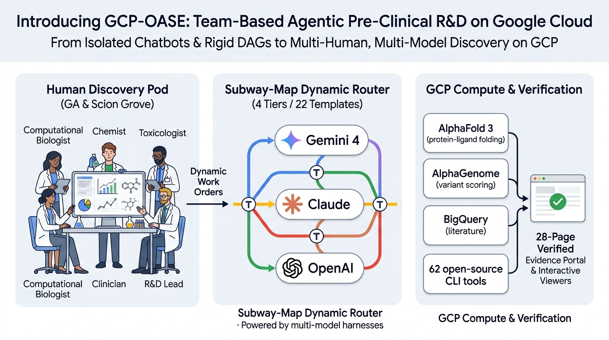
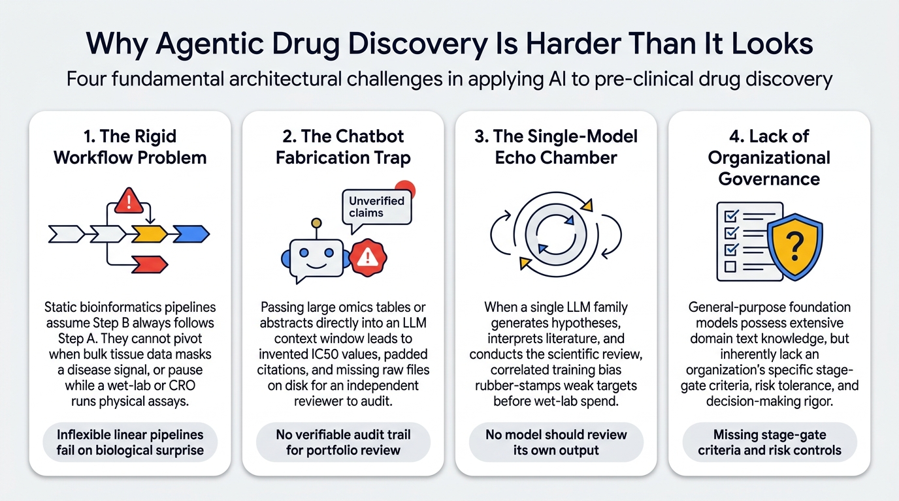
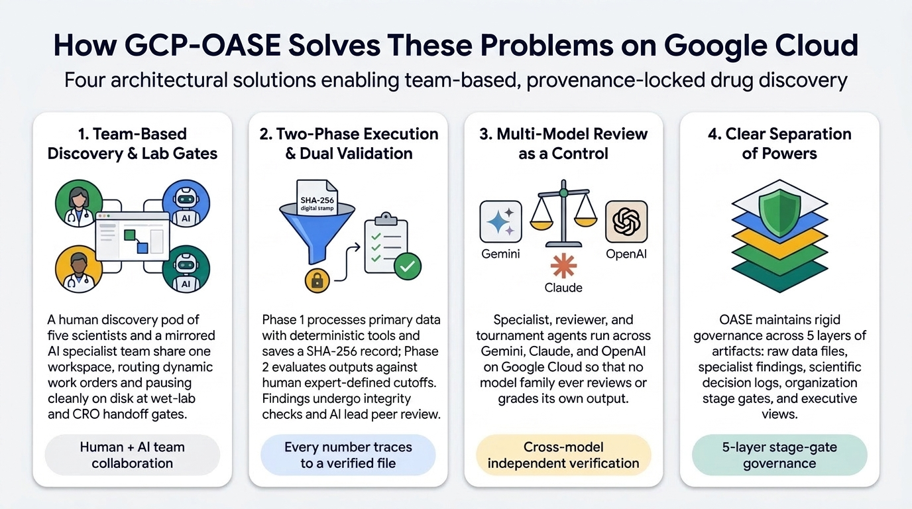
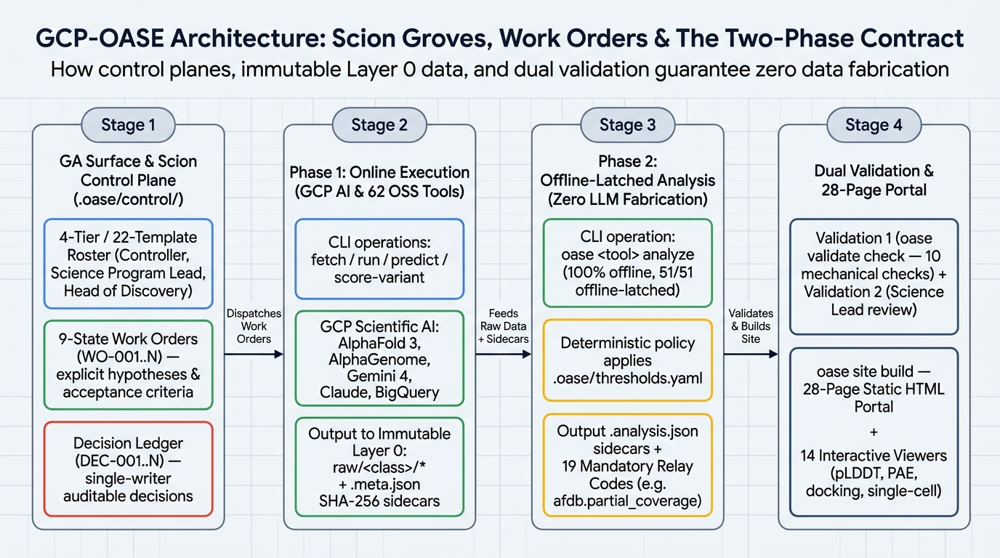
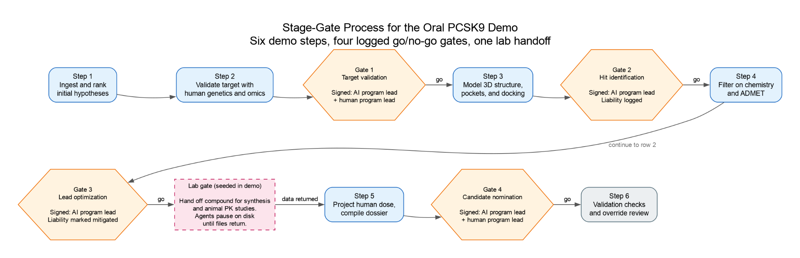
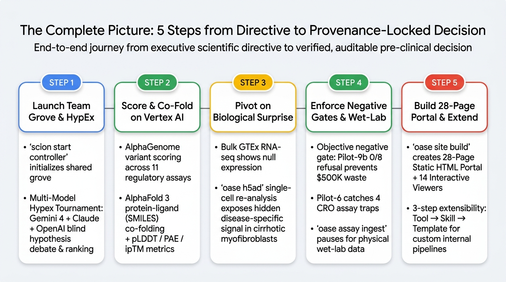

# Introducing GCP-OASE: Team-Based Agentic Drug Discovery on Google Cloud

## Start With Three "What If" Questions

When discovery scientists and R&D platform leads sit down to evaluate agentic AI for therapeutic programs, three questions separate an experimental chatbot demo from a system a portfolio review committee can actually trust:

1. **What if we had an agentic AI surface all of our scientists could use together at the same time?**  
   Instead of five scientists working in five isolated single-player chat tabs—copying and pasting summaries across computational biology, structural biology, medicinal chemistry, and DMPK—the entire human discovery pod shares a single live workspace (**The Grove**) alongside a mirrored team of specialist AI agents.
2. **What if we had optionality in the frontier models we use—not locking our science into one vendor or one model's blind spots?**  
   Instead of betting an entire R&D pipeline on a single model family that generates hypotheses and grades its own homework, **Gemini**, **Anthropic Claude**, and **OpenAI** run side-by-side on Google Cloud through portable model tiers so no model family ever peer-reviews its own output.
3. **What if every AI-assisted claim, threshold check, and stage-gate decision was cryptographically verified against raw data—so a portfolio review committee could audit and trust the dossier?**  
   Instead of summarizing raw tables inside an LLM prompt where numbers can be fabricated or caveats dropped, deterministic tools lock primary outputs on disk with **SHA-256 provenance receipts**, offline rules evaluate human-defined program cutoffs, and a 10-check validator blocks any unverified metric (`±1%`) or missing scientific limitation before a stage gate can close.

**Well — we built it.**

[Agentic AI in life sciences](https://cloud.google.com/life-sciences) is transforming how pre-clinical discovery teams evaluate therapeutic targets and design molecules. By connecting foundation models and computational biology tools across the drug discovery funnel, AI agents can now assist with everything from **human genetic target validation** that links population loss-of-function variants to disease, to **single-cell transcriptomics** that isolates disease-specific cell states, to **3D protein-ligand co-folding** and **multi-parameter lead optimization (DMTA)** that de-risk candidates before wet-lab synthesis.

Yet building production-ready agentic science that a pharma portfolio review committee can sign off on remains challenging. We built **GCP-OASE (Open Agentic Science Engine)** on **Google Cloud (GCP)** to change that. OASE is a drug discovery solution that traces AI model predictions, wet-lab measurements, computed results, and stage gate decisions. It does this on top of the SCION agent platform that is open-source, multi-agent and multi-user, to fit the dynamic needs of large drug discovery organizations.



---

## Quick Navigation — 150-Minute Hands-On Workshop Kit

| Role | Start Here | Deep-Dive Modules |
|---|---|---|
| **All Attendees & Facilitators (2.5-Hr Live Session)** | [**2.5-Hour Guided Lab Playbook (`docs/LAB_GUIDE_150M.md`)**](docs/LAB_GUIDE_150M.md) | [Interactive Story Arc & Lab Portal (`chapters.html`)](https://n0012.github.io/oase-workshop/chapters.html#lab) · [4-Tier Deploy & Test Guide (`docs/DEPLOY_AND_TEST.md`)](docs/DEPLOY_AND_TEST.md) |
| **Computational Biologist / Discovery Scientist** | [01 — Tour the Grove (`pcsk9-oral`)](docs/01-tour-the-grove.md) | [02 — Target Validation: Genetics & Omics](docs/02-target-validation-genetics-omics.md) · [03 — Structural Biology & Docking](docs/03-structure-docking-af3.md) · [04 — DMTA, PK & Dossier Portal](docs/04-dmta-pk-dossier-portal.md) |
| **AI Platform / Bioinformatics Engineer** | [Surface Connectivity Reference](docs/surface-connectivity-reference.md) | [00 — Prerequisites & Setup](docs/00-prerequisites.md) · [05 — Build & Register Custom Tools](docs/05-extend-custom-tools.md) · [07 — Troubleshooting & Validator Reference](docs/07-troubleshooting.md) |
| **Discovery Governance / Portfolio Review Lead** | [Working Backwards PRFAQ](PRFAQ.md) | [04 — DMTA, PK & Dossier Portal (Validation Drills)](docs/04-dmta-pk-dossier-portal.md) · [Data Provenance (`docs/DATA_PROVENANCE.md`)](docs/DATA_PROVENANCE.md) |
| **Workshop Facilitator / Field Team** | [06 — Facilitator Runbook](docs/06-facilitator-guide.md) | [Customer-Specific Workshop Overlays (`overlays/`)](overlays/README.md) · [07 — Troubleshooting & Validator Reference](docs/07-troubleshooting.md) |

---

## Why Agentic Drug Discovery Is Harder Than It Looks

Giving AI agents access to biological databases and structure predictors can accelerate target triage and hit-to-lead, but production implementation in a pharmaceutical R&D organization introduces four core challenges.



1. **The rigid workflow problem.** Traditional bioinformatics pipelines (Nextflow, Snakemake) and static workflow graphs assume Step B always follows Step A. That works for sequence alignment, but biological discovery requires adapting to new findings. When a bulk tissue RNA-seq query returns near-zero expression for a target, a fixed pipeline drops the gene, whereas a discovery team checks whether a specific disease-activated cell population expresses it in single-cell data. Furthermore, discovery programs pause after target validation or virtual screening to run physical assays internally or at a contract research organization (CRO), then resume weeks later when experimental data files return.
2. **The chatbot fabrication trap.** Many agent prototypes pass large omics tables, protein coordinates, or literature abstracts directly into an LLM context window and ask the model to summarize the numbers in prose. When a tool fails or a query returns an empty set, an unguarded model can invent a plausible binding value, pad citations, or confuse a missing gene column (`NA`) with zero expression (`0`). When data retrieval and threshold evaluation happen inside the prompt, there is no raw artifact on disk for an independent reviewer to verify.
3. **The single-model echo chamber.** Most enterprise AI tools rely on a single model family for the entire workflow. When the same model family generates a therapeutic hypothesis, interprets the literature, and conducts the scientific review, correlated training bias causes the model to agree with its own assumptions and advance weak targets into costly wet-lab campaigns.
4. **Lack of organizational governance in foundation models.** General-purpose LLMs possess extensive domain text knowledge, but inherently lack an organization's specific stage-gate criteria, risk tolerance, and decision-making rigor.

---

## How GCP-OASE Solves These Problems

**GCP-OASE (Open Agentic Science Engine)** on Google Cloud addresses each of these four challenges directly:



| Challenge | GCP-OASE Solution |
|---|---|
| **1. The rigid workflow problem** | **Team-Based Discovery & Dynamic Work Orders:** A **human discovery pod of five scientists** and a **mirrored AI agent team** collaborate in a shared workspace. The team routes dynamic work orders across a 9-state lifecycle and pauses cleanly on disk at wet-lab and CRO handoff gates until experimental data files return. |
| **2. The chatbot fabrication trap** | **Two-Phase Tool Execution & Dual Validation:** **Phase 1 (Data Acquisition):** Primary scientific datasets are processed by deterministic scientific tools rather than passed through an LLM prompt, and raw results are written to disk alongside a cryptographic (SHA-256) provenance record. **Phase 2 (Pre-Registered Threshold Evaluation):** Executes offline to evaluate those primary outputs against human expert-defined program cutoffs. Before any finding is accepted, it must pass both automated data-integrity verification and an independent scientific peer review by the AI program lead. |
| **3. The single-model echo chamber** | **Model Diversity as a Scientific Control:** Specialist, reviewer, and tournament agents are configured across different model families (**Gemini**, **Claude**, and **OpenAI**) on Google Cloud so that no model family ever reviews its own output. |
| **4. Lack of organizational governance in foundation models** | **Clear Separation of Powers Across 5 Artifact Layers:** OASE maintains rigid governance across 5 layers of artifacts: **raw data files**, **specialist findings**, **scientific decision logs**, **organization stage gates**, and **executive views**. |

---

## GCP-OASE Data and Control Architecture

OASE organizes every discovery program around four core pillars: **The Grove**, **Work Orders and Dual Validation**, **Two-Phase Tool Execution**, and **Stage-Gate Review**.



| Pillar | The Question It Answers | In Plain Terms |
|---|---|---|
| **1. The Grove** | *Who is doing the work?* | The grove is the shared workspace for one program, and it holds two teams. The **human team** is a discovery pod of five human scientists: a program lead, a computational biologist, a structural biologist, a medicinal chemist, and a DMPK and safety lead. The **agent team** mirrors those disciplines with one specialist AI agent per field, plus an AI program lead, an independent reviewer, and a validator. Agents are spread across different model families (Gemini, Claude, OpenAI) so that no model reviews its own output. Only the AI program lead may write official program decisions. |
| **2. Work Orders and Dual Validation** | *How is each piece of work tracked and checked?* | Every scientific question the team asks becomes a work order. It is assigned to a specialist agent, produces raw data and a written finding, and cannot close until it passes two independent checks. The first is mechanical: ten automated tests confirm that every number in the finding traces to a data file, that no data file has been altered, and that every required caveat is present. The second is scientific: the AI program lead independently re-examines the evidence and records whether it accepts the conclusion. |
| **3. Two-Phase Tool Execution** | *Why can the numbers in the reports be trusted?* | Every tool runs in two separate steps. First, primary scientific datasets are processed by deterministic scientific tools and raw output is saved to disk with a cryptographic (SHA-256) provenance receipt recording the version, parameters, and file fingerprint. Second, with network access switched off, that saved output is evaluated against human expert-defined program cutoffs fixed in advance, and the verdict is written to an analysis file. A specialist's report may only quote numbers from the analysis file, and each quote must cite it. |
| **4. Stage-Gate Review** | *Who decides whether the program moves forward?* | Work orders roll up into five formal stage gates, each logged with its evidence, decision, and signer:<br>1. **Target validation (Gate 1):** AI program lead recommends; human program lead signs.<br>2. **Hit identification (Gate 2):** AI program lead advances if preset cutoffs pass and logs any liabilities.<br>3. **Lead optimization (Gate 3):** AI program lead advances once liabilities are resolved.<br>4. **Lab handoff (⏸ Lab Gate):** Human program lead signs; agents pause cleanly on disk until experimental assay files return.<br>5. **Candidate nomination (Gate 4):** AI program lead recommends; human program lead signs. |

### Worked Example of Two-Phase Execution: The Pocket Check in Step 3

| Phase | What Happens | What Is Written to Disk |
|---|---|---|
| **Phase 1: run the tool** | A cavity-detection program (`fpocket`) scans the PCSK9 3D structure. No judgment is made. | The raw output (pocket 1 scores `0.68`, pocket 2 scores `0.24`) and a receipt (`.meta.json`) recording the tool version, its parameters, and a SHA-256 fingerprint of the output file. |
| **Phase 2: score offline** | With the network off, the scores are compared against the program's druggability cutoff of `0.50`. | An analysis file (`.analysis.json`) holding the verdict (a druggable pocket was found), the cutoff used, the fingerprint of the file it graded, and a required caveat that a druggability score describes cavity shape rather than measured ligand binding affinity. |
| **Report** | The structural-biology agent writes up the result. | A finding markdown file in which the `0.68` carries an inline citation to the analysis file and the required caveat appears word for word. |

---

## What You'll See in This Demo

The demo follows one program end to end: **identify and evaluate an oral, once-daily small-molecule inhibitor of PCSK9 to increase hepatic LDL receptor recycling, as an alternative to injectable antibodies.**

Two teams share one workspace:
- **The human team** is a discovery pod of five human scientists: a program lead, a computational biologist, a structural biologist, a medicinal chemist, and a DMPK/safety lead, each working from their own browser, Gemini, or IDE surface.
- **The agent team** mirrors those disciplines: an AI program lead, eight AI domain specialists (covering computational biology, structural biology, computational chemistry, medicinal chemistry, experimental biology, ADMET/DMPK, toxicology, and regulatory), an independent AI reviewer, and a validator, configured across different model families so that no model reviews its own outputs.

The agents execute the tools and draft the reports; the humans commission work orders, review outputs, and approve stage gates. Each step below corresponds to a standard preclinical decision and shows how the supporting evidence is recorded.



| Step | Decision Question | What Happens in the Demo | Tool / Computation Model | User (Scientist Role) |
|---|---|---|---|---|
| **1. Ingest and rank initial hypotheses** *(in silico)* | Which therapeutic hypothesis and mechanism of action should we evaluate first? | Results from a prior AI "co-scientist" tournament are ingested into the workspace. The top-ranked allosteric small-molecule hypothesis is selected as the starting point, and the record logs a required caveat noting that the hypothesis was adopted from an upstream run rather than generated in this campaign. | **AI Co-Scientist & Multi-Model Elo Tournament** (`oase coscientist` / `Hypex` pairwise debate across Gemini, Claude & OpenAI) | **Program Lead & Computational Biologist** |
| **2. Validate the target with human genetics and omics** *(in silico)* | Does human genetic and expression data support efficacy and safety for this target? | The agents query three lines of evidence: human loss-of-function constraint (confirming that humans lacking functional PCSK9 are healthy), disease-association genetics, and tissue expression selectivity in liver. **AlphaGenome** on Google Cloud scores a non-coding regulatory variant for effects on gene expression. Each raw output is saved with a SHA-256 hash, evaluated against pre-defined thresholds, and summarized in a finding report with inline file citations for each metric. | **AlphaGenome on GCP** (1 Mb regulatory variant scoring), **gnomAD** (LoF constraint), **OpenTargets / ClinVar** (GWAS), **GTEx / HPA** (tissue expression) | **Computational Biologist / Human Geneticist** |
| **3. Model 3D structure, pockets, and ligand docking** *(in silico)* | Is there a druggable pocket on the protein, and how well do candidate scaffolds fit? | Using the target ID from Step 2 and the candidate scaffolds from Step 1, the agents retrieve the monomer structure, run **AlphaFold 3 on Google Cloud** to co-fold the protein with a candidate ligand, score surface cavities for druggability, and dock five candidate analogs. One analog produces the strongest predicted binding score, and the report includes a required caveat that a docking score is an estimate rather than a measured binding affinity. | **AlphaFold 3 on GCP** (protein + SMILES co-folding), **AlphaFold DB**, **fpocket** (Monte Carlo cavity druggability), **AutoDock Vina** (3D pose docking) | **Structural Biologist & Computational Chemist** |
| **4. Filter candidates on multiparameter chemistry and ADMET** *(in silico)* | Does the top-scoring compound from docking meet physicochemical, safety, and synthesis criteria? | Using the Step 3 chemical structures, the agents calculate physicochemical properties, screen for structural alerts, evaluate matched-molecular-pair replacements, and estimate a 4-step synthesis route. The highest-scoring compound from docking exceeds the lipophilicity cutoff and triggers a cardiac-safety (hERG) structural alert. A polar analog with a slightly weaker docking score passes all property and alert filters, and is selected to advance with the specific rule evaluations recorded in the analysis file. | **Multi-Parameter Lead Optimization (DMTA):** **RDKit** (physicochemical descriptors), **ADMET Structural Alerts** (PAINS / Brenk / Aronov hERG), **BRICS** (matched molecular pairs), **ASKCOS** (retrosynthesis) | **Medicinal Chemist** |
| **⏸ Lab gate** *(required before Step 5; seeded in demo)* | What is needed to test the selected compound experimentally and bring the results back? | Steps 1–4 are entirely *in silico* and produce a proposed chemical structure. Step 5 requires measured rat and dog oral bioavailability (`54%` and `61%`), which in practice requires chemical synthesis and *in vivo* pharmacokinetic studies. In a live project, OASE prepares a **lab handoff work order** here, **agents pause cleanly on disk until files return** from the lab or CRO, and OASE ingests the returned data files. For the 150-minute workshop, these returned PK measurements are provided as a pre-staged dataset. | **Stopping-Gate Handoff & Assay Re-Ingestion** (`oase retro` route spec, `.oase/thresholds.yaml` pass/fail criteria, `oase assay ingest`, `oase selectivity compare`, `oase pk ingest`) | **Medicinal Chemist, Experimental Biologist & DMPK Lead** |
| **5. Project human dosing and compile the dossier** *(in silico on lab-gate data)* | Do the animal PK results support once-daily human oral dosing, and is the full evidence package complete? | The rat and dog bioavailability figures are checked against the program's oral PK threshold to project a human once-daily dose (`40 mg QD`, `F = 52%`, `t1/2 = 14.8 h`), accompanied by a required caveat that two-species projections require clinical verification. Findings across all eight work orders are then compiled into a candidate dossier and a static HTML evidence portal where each number links to its underlying data file. | **Non-Compartmental Analysis & Two-Species Allometric PK Scaling** (`oase pk`), **ClinicalTrials.gov & OpenFDA FAERS** (`oase trials`/`faers`), **Dossier & Static Portal Compiler** (`oase dossier`/`site`) | **DMPK, Safety & Regulatory Lead** |
| **6. Run validation checks and review overrides** *(in silico)* | How does the system verify that reports match the underlying data and track human or lead overrides? | Four test cases are run against the validator: removing a required caveat from a report, altering a cited number beyond the `±1%` tolerance, modifying a raw data file so its hash no longer matches, and recording a reviewer override of a specialist's interpretation. The validator blocks work-order closure on the first three cases and permits the fourth while recording the override, actor, and rationale in the decision log. | **Deterministic 10-Check Governance Validator** (`oase validate check`: SHA-256 provenance, `±1%` JSONPath citation verification, mandatory relay checks) & **Audited Override** (`oase workorder override`) | **Program Lead / Discovery Governance Lead** |

### How the Co-Scientist Input Prompt Defines the Subway Map (Not a Rigid Pipeline)

A single recorded campaign replay (`Steps 1–6` above) looks linear after the fact—just like tracing one rider's trip across a city makes a transit network look like a single track. Underneath, **GCP-OASE operates like a dynamic subway map**: the upstream **AI Co-Scientist Research Brief** ([`prompts/coscientist-research-brief.md`](prompts/coscientist-research-brief.md) / [`campaign-seed.json`](checkpoints/ch0/seed/pcsk9-oral/campaign-seed.json)) sets the destination, parallel lines, and pre-registered kill criteria, while **what each deterministic tool actually returns** switches the active track at every transfer station:

- **Research Goal & Modality Preferences (`coscientist-export.json`):** *Evaluate oral allosteric small-molecule and tricyclic macrocycle PCSK9 inhibitors disrupting LDLR EGF-A binding in ASCVD—prioritizing classical Rule-of-5 oral hepatocyte bioavailability (without dietary permeation enhancers) and human loss-of-function genetic cardioprotection (`PCSK9 R46L` / `gnomAD LoF`).*
- **Pre-Registered Falsifiable Kill Criteria (`campaign-seed.json`):**
  - **`FP-001` (Primary Line `IC-001` — Allosteric Small Molecule):** Requires cryptic inter-domain pocket `druggability >= 0.50` (`fpocket`) and `AlphaFold 3` ligand `ipTM >= 0.70`; **kill criterion:** `druggability < 0.30` or steric clash across all conformers.
  - **`FP-002` (Backup Line `IC-002` — Tricyclic Macrocycle):** Benchmarked against clinical macrocycle `MK-0616` on the flat `EGF-A` patch; retained on a parallel backup line because of higher `MW` and permeation-enhancer requirements.

| Transfer Station | Upstream Seed Rule | What Returned in `pcsk9-oral` (Active Track) | Dynamic Track Switch If Data Came Back Differently |
|---|---|---|---|
| **Station 0 — Co-Scientist Seed (`WO-001`)** | Unenhanced oral Ro5 preference (`coscientist@1.1+program`) | `IC-001` leads by **`+54.5 Elo`** (`1642.5` vs `1588.0`) → opens **Green Line (`IC-001`)** & parks **Amber Backup Line (`IC-002`)**. | **Tied Elo (`<25 ΔElo`):** `@science-program-lead` dispatches parallel Stage 2 pocket & PPI work orders on both lines simultaneously. |
| **Station 1 — Genetics & Omics (`WO-002..003`)** | Hepatic selectivity + human LoF tolerance (`pLI < 0.90`) | Bulk `GTEx` liver = **`184.2 TPM`** (`tau = 0.93`) + `AlphaGenome` `0.984` → **Express Track to Gate 1**. | **Low Bulk Expression (`<5 TPM`):** Instead of dropping the gene like a static DAG, switches onto the **`oase h5ad` Single-Cell Transcriptomics Detour** to check disease-activated subpopulations. |
| **Station 2 — 3D Pocket & Docking (`WO-004..005`)** | `FP-001`: `druggability >= 0.50`, kill `< 0.30` | Cryptic `Pocket #1` scores **`0.68`** (`0.788` live apo) while flat `EGF-A` scores **`0.24`** (`Analog-05` clashes at `1.72 Å` ✗) → **Green Line advances; Ro5 orthosteric spur terminates**. | **Cryptic Pocket `< 0.30` (`FP-001` Kill Triggered):** Terminates `Line A` small-molecule campaign at Gate 2 and transfers pod onto **Amber Backup Line `IC-002` (Macrocycle / Biologic)**. |
| **Station 3 — Med-Chem DMTA (`WO-006`)** | Ro5 oral brief locks `max_clogp <= 3.5`, `0` critical alerts | Top docker `PCSK9-A02` (`-9.4 kcal/mol`) hits a **Red Signal** (`cLogP = 5.09`, Aronov `hERG` alert ✗) → **Med-Chem `BRICS` Reroute Loop** rescues polar oxadiazole **`OASE-PCSK9-014`** (`cLogP = 3.01`, `0` alerts ✓). | **Clean Top Docker:** Advances straight to **⏸ Wet-Lab Gate** without an MMP redesign cycle. **Unresolvable Series Liability:** Loops back to Station 2 alternate chemotype. |
| **Station 4 — ⏸ Wet-Lab Gate & PK (`WO-007..008`)** | Manual CRO stopping gate + human QD oral PK (`F >= 30%`) | Rat (`54%`) & dog (`61%`) oral `F` return → **`40 mg QD` human oral tablet** nominated at **Gate 4**. | **Failed Wet-Lab `SPR` or `F < 10%`:** Reopens **Amber Backup Line (`PCSK9-B07` macrocycle)** via audited human governance override (`oase workorder override`, demonstrated in Step 6). |

---

## Walking Through the Six Demo Steps in Code

In the 150-minute workshop, participants run or inspect each of the six steps above using pre-staged checkpoints (`ch0` through `ch4`) so every command completes in seconds.

### Steps 1 & 2: Hypothesis Ingestion and Human Genetic Target Validation (`WO-001`–`WO-003`)

In Step 1, the Computational Biologist and Program Lead ingest the upstream AI Co-Scientist tournament results (`oase coscientist`), locking the top-ranked allosteric PCSK9 hypothesis (`IC-001`, Elo `1642.5`) while recording the required caveat `hypothesis.adopted_not_generated`.

In Step 2, the Computational Biologist queries `gnomAD` loss-of-function constraint, `OpenTargets` genetic association, `GTEx` liver expression selectivity, and **AlphaGenome on Google Cloud** for regulatory variant scoring:

```bash
source /scion-volumes/tools/env.sh
export OASE_PROJECT=/scion-volumes/scratchpad

# Phase 1 (Online): Score PCSK9 regulatory variant rs2479409 on AlphaGenome GPU endpoint
oase alphagenome score-variant \
  --chrom chr1 \
  --pos 55039974 \
  --ref G \
  --alt T \
  --window 1048576 \
  --output-type RNA_SEQ \
  --output-type DNASE \
  --organism HOMO_SAPIENS

# Phase 2 (Offline): Grade saved raw output against .oase/thresholds.yaml
oase alphagenome analyze raw/genomics/chr1_55039974_G_T.json

# Query and grade human loss-of-function genetics, GWAS, and hepatic tissue expression
oase genetics fetch PCSK9 && oase genetics analyze PCSK9
oase gwas search PCSK9 --source opentargets && oase gwas analyze PCSK9 --source opentargets
oase gtex fetch PCSK9 && oase gtex analyze PCSK9
```

When Stage 1 completes, **Gate 1 (Target Validation)** is co-signed by the AI program lead (`science-program-lead`) and the human program lead before Stage 2 begins.

---

### Step 3: 3D Structure Modeling, Pocket Druggability, and Ligand Docking (`WO-004`–`WO-005`)

Using the validated PCSK9 target (`Q8NBP7`) and the candidate scaffold series from Step 1, the Structural Biologist and Computational Chemist retrieve the monomer structure, evaluate the **AlphaFold 3** protein-ligand co-fold, scan surface cavities with `fpocket`, and dock five analogs with `AutoDock Vina`:

```bash
# Phase 1 & Phase 2: AlphaFold monomer confidence + fpocket cavity druggability on PCSK9
oase alphafold fetch Q8NBP7 && oase alphafold analyze Q8NBP7
oase pocket run raw/structures/AF-Q8NBP7-F1.cif --strip-peptides
oase pocket analyze raw/pocket/Q8NBP7_pockets.json --druggable 0.50

# Phase 1 & Phase 2: 3-phase pose docking across the 5 candidate analogs
oase docking prepare raw/structures/Q8NBP7.cif raw/pocket/Q8NBP7_pockets.json --pocket-rank 1 --protein-only
oase docking run raw/docking/Q8NBP7_receptor.pdbqt raw/docking/Q8NBP7_pocket1_gridbox.json raw/compounds/pcsk9_analog_0*.sdf
oase docking analyze raw/docking/runs/pcsk9_analog_0*.dock.json
```

`Pocket 1` scores `0.68` (passing the `0.50` druggability threshold, whereas the flat `EGF-A` surface scores `0.24`), and analog `pcsk9_analog_02` achieves the strongest predicted docking score (`-9.4 kcal/mol`, `2.34 Å` clearance), accompanied by the required caveat `docking.score_is_not_affinity`. At **Gate 2 (Hit Identification)**, the AI program lead approves advancement to multiparameter chemistry optimization while logging the lipophilicity and basic-amine cardiac safety liability (`L-002`) for investigation.

---

### Step 4 & Lab Gate: Multiparameter Chemistry, ADMET Filtering, and Lab Handoff (`WO-006`)

In Step 4, the Medicinal Chemist runs `RDKit` descriptor profiling, `BRICS` matched-molecular-pair analysis, `ASKCOS` retrosynthesis, and rule-based ADMET structural alert screening across the docked analogs:

```bash
# Evaluate physicochemical properties, matched molecular pairs, and ADMET structural alerts offline
oase mmp analyze raw/mmp/pcsk9_ic001_series.mmp.json
oase admet analyze raw/admet/pcsk9_ic001_series.admet.json
```

The analysis files reveal a classic medicinal chemistry trade-off:
- **Unoptimized high-scoring dockers** (`pcsk9_analog_02` at `cLogP = 4.8` in the seeded series, and `PCSK9-A02` at `cLogP = 5.09` in live single-compound CLI screening) exceed the lipophilicity cutoff (`max_clogp = 3.5`) and trigger cardiac-safety (**Aronov hERG**) and metabolic liabilities.
- **Optimized polar heterocycle `OASE-PCSK9-014`** (2-methoxypyrimidine / polar oxadiazole bioisostere `PCSK9-A03`) lowers `cLogP` to `3.1` (`3.01` in live single-SMILES screening), raises lipophilic efficiency `LipE` to `5.2` (`MW = 462.5 Da`, `TPSA = 88.4 Ų`, `4`-step convergent synthesis), and passes every physicochemical and ADMET filter with **zero structural alerts**.

At **Gate 3 (Lead Optimization)**, the AI program lead selects `OASE-PCSK9-014`, marks cardiac/lipophilicity liability `L-002` mitigated in `program-state/liability-tracker.md`, and advances to the **Lab Gate**—where the human program lead signs the synthesis and *in vivo* pharmacokinetic handoff work order, and the agents pause cleanly on disk until experimental rat (`F = 54%`) and dog (`F = 61%`) oral bioavailability files return.

---

### Steps 5 & 6: Human Dose Projection, Evidence Portal Compilation, and Validation Checks (`WO-007`–`WO-008`)

Once the animal PK data files return from the lab gate, the DMPK and Regulatory leads project human oral dosing (`40 mg QD`, `F = 52%`, `t1/2 = 14.8 h`), benchmark `84` clinical trials (`0` approved oral non-peptide small molecules), and compile the candidate nomination dossier and static HTML evidence portal:

```bash
# Grade returned PK data and project human once-daily oral dose
oase pk analyze raw/pk/oase_pcsk9_014_scaled_pk.json

# Run all 10 deterministic validation checks across WO-001..WO-008
oase validate check WO-008
oase doctor

# Compile the static HTML Evidence Portal and interactive chapter replay
oase site validate
oase site build
oase site export
```

At **Gate 4 (Candidate Nomination)**, both the AI program lead (`science-program-lead`) and the human program lead co-sign the nomination of `OASE-PCSK9-014`.

Finally, in **Step 6**, the Program Lead runs the four governance test cases—verifying that `oase validate check` blocks work-order closure when a required caveat is removed (`REL-001`), when a cited number is altered beyond `±1%` (`CIT-003`), or when a raw data file is modified (`PROV-002`), while permitting an explicitly logged reviewer override (`oase workorder override`) with full actor and rationale attribution in `program-state/decision-log.md`.

---

## Five Engineering Takeaways From Deploying OASE v0.3.0 on Google Cloud

Running the oral PCSK9 campaign end to end on Google Cloud surfaced five practical engineering lessons that are built into the workshop repository (`scripts/provision-gcp-project.py`, `scripts/bootstrap-oase-env.sh`, and `scripts/run-e2e-simulation.sh`):

1. **Program-Level Threshold Configuration (`oase/core/thresholds.py`):**
   Thirteen of the 36 built-in threshold schemas (`gtex-expression@1.0`, `docking-scores@1.0`, `gnomad-constraint@1.0`, `pk-parameters@1.0`, etc.) intentionally ship with `UNRESOLVED` sentinels so each organization must declare its own cutoffs in `.oase/thresholds.yaml` before Phase 2 analysis can run. All 36 schemas are pre-populated in `checkpoints/ch0`..`ch4`.
2. **One Citation Tag Per Line for Clean HTML Rendering (`oase site build`):**
   `oase validate check` verifies inline citations in `{source: <path> $.metrics.<field>}` format within `±1%` tolerance. Placing at most one `{source: ... $.metrics.x}` tag per bullet line prevents the Markdown math preprocessor from interpreting pairs of `$` symbols as LaTeX math blocks.
3. **Pre-Built Scientific Toolchain (`scripts/bootstrap-oase-env.sh`):**
   Compiling the seven scientific C/C++ binaries (`vina`, `fpocket`, `rate4site`, `muscle`, `hypex`, `elo`, `prox`) and the Python 3.11 science stack (`rdkit`, `prody`, `biopython`, `scipy`, `openbabel`) into `/scion-volumes/tools` once per host allows every specialist container to start immediately with a verified toolchain (`oase doctor`).
4. **Transparent Rule Attribution in Heuristic Filters (`oase/commands/admet.py`):**
   Because Phase 2 writes the exact rule inputs (`has_basic_nitrogen`, `logp`, `aromatic_rings`) into `.analysis.json`, medicinal chemists can inspect why `PCSK9-A02` (`cLogP = 5.09`) triggered the Aronov hERG rule and verify how `PCSK9-A03` (`cLogP = 3.01`) cleared the threshold.
5. **Clear Boundary Between Computational Estimates and Experimental Data:**
   OASE treats computational scores (`AutoDock Vina` pose scores, 2D ADMET alerts, allometric PK scaling) as hypotheses with mandatory caveats, and pauses at explicit lab handoff gates when physical synthesis and wet-lab measurements are required.

---

## The Complete Picture

Across six steps, four logged go/no-go stage gates, and one lab handoff, the human discovery pod and the multi-model agent team progressed from an initial hypothesis tournament to human genetic validation, 3D pocket and docking analysis, multiparameter ADMET optimization, human oral dose projection, and a cryptographically verified candidate dossier:



---

## How to Guide the 2.5-Hour (150-Minute) Hands-On Lab

To run GCP-OASE as a live **2.5-hour (`150-minute`) interactive session** for discovery scientists and platform engineers, start with the **Three "What If" Questions** above, pivot into the live Story Arc Cockpit (*"Well — we built it"*), and seat participants across the **five Discovery Pod roles** (`Dr. Sarah Chen` Program Lead, `Dr. Marcus Vance` Comp Bio, `Dr. Elena Rostova` Structural Bio, `Dr. Raj Patel` Med Chem, and `Dr. Claire Moreau` DMPK & Safety). Full step-by-step facilitator and participant instructions—with copyable `@mention` prompts, CLI commands, and red-team tamper exercises—live in [**`docs/LAB_GUIDE_150M.md`**](docs/LAB_GUIDE_150M.md) and the [**`2.5-Hr Lab Guide` tab of `chapters.html`**](https://n0012.github.io/oase-workshop/chapters.html#lab):

| Time | Duration | Lab Block | Active Pod Seats & Checkpoints | Hands-On Exercise & Lightbulb Moment |
|---|---|---|---|---|
| **`0:00–0:15`** | `15 min` | **Block 0 — Three "What Ifs" → *"Well, We Built It"*** | All 5 Seats (`ch0`) | Debate the 3 "What If" provocations, reveal `chapters.html`, tour the 5 artifact layers, and claim the 5 scientist logins (`oase-sarah`..`oase-claire`). |
| **`0:15–0:40`** | `25 min` | **Block 1 — Multiplayer Grove & Target Validation** | `Sarah` + `Marcus` (`ch1 → ch2`) | Join the same Scion Grove thread simultaneously (multiplayer + multi-model), interrogate `WO-001` Elo + `gnomAD` / `GTEx` / `AlphaGenome`, inspect `.oase/thresholds.yaml`, and co-sign **Gate 1**. |
| **`0:40–1:10`** | `30 min` | **Block 2 — 3D Co-Folding, Cryptic Pockets & Docking** | `Elena` + `Raj` (`ch2 → ch3`) | Compare `AlphaFold 3` co-fold + `fpocket` cryptic groove (`0.68` / `0.788` live apo) vs flat `EGF-A` (`0.24`), inspect `AutoDock Vina` poses (`-9.4 kcal/mol`), verify `docking.score_is_not_affinity`, and sign **Gate 2** with liability `L-002`. |
| **`1:10–1:45`** | `35 min` | **Block 3 — ADMET Takedown, Wet-Lab Gate & Oral PK** *(incl. 5m break)* | `Raj` + `Claire` (`ch3 → ch5`) | Disqualify top docker `PCSK9-A02` (`cLogP = 5.09`, Aronov `herg_liability`), advance polar oxadiazole `OASE-PCSK9-014` (`cLogP = 3.01`, `0` alerts), walk through the **⏸ Wet-Lab CRO Stopping Gate**, verify `40 mg QD` oral PK (`F = 52%`), and co-sign **Gate 4**. |
| **`1:45–2:10`** | `25 min` | **Block 4 — Red-Team the Validator (Break the Science)** | `Elena` + All Seats (`ch6`) | **Hands-on tamper challenge:** alter a byte in `raw/` (`PROV-002`), inflate `-9.4` to `-11.2 kcal/mol` (`CIT-003`), delete a caveat relay (`REL-001`), watch `oase validate check` block all three (`exit=1`), execute an audited human override (`DEC-OVERRIDE-001`), and test `<2s` **`↺ Reset CH6`**. |
| **`2:10–2:30`** | `20 min` | **Block 5 — Portfolio Readout, Custom Tools & Own-GCP Pilot** | `Sarah` + Platform Leads (`ch7`) | Tour the 30-page static Evidence Portal (`WO-008`), inspect the two-phase custom tool adapter (`oase h5ad`), and scope a 2-week pilot in your own GCP project ([`docs/DEPLOY_AND_TEST.md`](docs/DEPLOY_AND_TEST.md)). |

### Try It Yourself

- **2.5-Hour Guided Lab Playbook (`0:00–2:30`):** Follow [**`docs/LAB_GUIDE_150M.md`**](docs/LAB_GUIDE_150M.md) or open the interactive [**`2.5-Hr Lab Guide`**](https://n0012.github.io/oase-workshop/chapters.html#lab).
- **End-to-End Stage 0 → 4 Operational Curriculum (`pcsk9-oral`):** Walk through [Module 01 — Tour the Grove](docs/01-tour-the-grove.md), [Module 02 — Target Validation: Genetics & Omics](docs/02-target-validation-genetics-omics.md), [Module 03 — Structural Biology & Docking](docs/03-structure-docking-af3.md), and [Module 04 — DMTA, PK & Dossier Portal](docs/04-dmta-pk-dossier-portal.md) across `WO-001`..`WO-008`.
- **Prerequisites & Turnkey GCP Deployment:** Start with [Module 00 — Prerequisites & Setup](docs/00-prerequisites.md), run `./scripts/preflight.sh`, and see [4-Tier Deploy & Test Runbook (`docs/DEPLOY_AND_TEST.md`)](docs/DEPLOY_AND_TEST.md).
- **Extend OASE with Custom Tools:** See [Module 05 — Build & Register Custom Tools](docs/05-extend-custom-tools.md).
- **Facilitator Runbook & Troubleshooting:** See [Module 06 — Facilitator Runbook](docs/06-facilitator-guide.md) and [Module 07 — Troubleshooting & Validator Reference](docs/07-troubleshooting.md).
