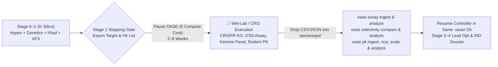

# Module 04 — Make It Yours: Fast-Progressing Stage 0→4 Campaigns, Threshold Tuning & Wet-Lab / CRO Handoffs

> **Duration:** 30 Minutes (`1:30 – 2:00`)  
> **Hands-On Goal:** Launch a **fast-progressing Stage 0 → 4 small-molecule campaign** (`~45 min` live / `<5 min` via checkpoints) from our benchmark target menu, customize `.oase/thresholds.yaml` without re-running expensive Phase 1 GCP GPU calls, configure a **Wet-Lab / CRO Stopping Gate**, and re-ingest experimental assay data (`oase assay`, `oase selectivity`, `oase pk`).

---

## 1. Fast-Progressing Stage 0 → 4 Small-Molecule Campaign Candidates (`seed_mode=sciarchitect`)

Why do some discovery campaigns take hours while others progress cleanly through **Stages 0 → 1 → 2 → 3 → 4 in ~45 minutes live**?
- **Root Causes of Multi-Hour Bottlenecks in Prior Pilots:** (1) Running an unconstrained 46-agent Stage 0 `hypex` swarm across 15 unseeded targets (`pilot-9c`), (2) encountering unindexed single-cell `.h5ad` cell-type vocabularies requiring in-run custom tool synthesis (`pilot-10`), or (3) selecting targets with weak human genetics or negative clinical trials that rightly trigger a Stage 0 termination gate (`pilot-9b`).
- **Fast-Progression Architecture (~45-Minute Full Stage 0 → 4 Live Execution):** By initiating from Gemini Agent (`bootstrap_campaign` with `seed_mode=sciarchitect` at `stage0_verification`) on a target with unambiguous human genetics, a high-resolution PDB (`< 2.2 Å`), and an established ChEMBL SAR series, your pod exercises every stage end-to-end:

| Campaign Candidate | Therapeutic Area & Modality | Stage 0 → 4 Fast-Progression Profile (~45 Min Live / Instant Checkpoints) |
|---|---|---|
| **Candidate 1 (Recommended Primary): Oral Allosteric `PCSK9` (or `LPA`) Small-Molecule / Peptidomimetic Inhibitor in ASCVD** | Cardiometabolic / ASCVD — converting injectable anti-PCSK9 biologics into oral QD small molecules or macrocyclic peptidomimetics | **Stage 0 (~8m):** Unambiguous human LoF cardioprotection (`rs11591147` R46L, Y142X; `gnomAD pLI = 0`, `OpenTargets > 0.95`) guarantees clean Stage 0 gate passage.<br>**Stage 1 (~10m):** Live **AlphaGenome on GCP** (`oase alphagenome score-variant`) on hepatocyte regulatory variant `rs2479409` / `1p13.3` + `oase gtex` confirming liver-restricted expression.<br>**Stage 2 (~12m):** Live **AlphaFold 3 on GCP** (`--template ligand`) co-folding an allosteric C-terminal/LDLR-interface ligand + `PDB: 2P4E/3P5B` + `fpocket` + `<90s` `vina` docking on 5 ChEMBL analogs.<br>**Stage 3 (~8m):** `oase mmp` (BRICS), `oase admet` (TPSA/permeability/LipE optimization, hERG clean), `oase retro` (ASKCOS).<br>**Stage 4 (~7m):** `oase pk` (oral QD hepatic coverage), `oase trials`/`faers` differentiation, and `oase dossier` + `oase site build`. |
| **Candidate 2 (Precision Oncology): MTA-Cooperative `PRMT5` Small-Molecule Inhibitor in `MTAP`-Deleted Solid Tumors** | Precision Oncology / Synthetic Lethality — exploiting `9p21 CDKN2A/MTAP` homozygous co-deletion in solid tumors while sparing normal bone marrow | **Stage 0–1 (~15m):** Clear `cBioPortal` / DepMap synthetic lethality (`oase cbioportal`) + **AlphaGenome on GCP** regulatory scoring at `9p21`.<br>**Stage 2 (~12m):** Ternary `PRMT5•MTA•ligand` co-folding in **AlphaFold 3 on GCP** (`PDB: 4X61/8UOB`) + differential `vina` docking (MTA-bound tumor state vs. SAM-bound normal state).<br>**Stage 3–4 (~15m):** Selectivity-ratio SAR optimization (`oase mmp`, `oase admet`) and quantitative hematologic safety-margin modeling (`oase tox`, `oase pk`, `oase dossier`). |
| **Candidate 3 (Cardiometabolic-Inflammation): Oral `NLRP3` NACHT-Domain Allosteric Inhibitor in Obesity-Associated Inflammation / MASH** | Cardiometabolic-Inflammation — inflammasome blockade in cardiometabolic tissue remodeling | **Stage 0–1 (~15m):** Fast myeloid/Kupffer single-cell validation (`oase cellxgene`, `oase h5ad`) + **AlphaGenome on GCP** enhancer scoring.<br>**Stage 2 (~12m):** **AlphaFold 3 on GCP** ligand co-folding + `fpocket`/`vina` docking into the NACHT Walker A/B pocket (`PDB: 7ALV/6NPY`) across ChEMBL sulfonylurea/tricyclic series.<br>**Stage 3–4 (~15m):** Replacing furan/reactive-metabolite DILI structural alerts via `oase mmp` + `oase admet` and building the IND dossier (`oase dossier`). |
| **Candidate 4 (Fibrosis / Immunology Custom):** `LOXL2` (`Q9Y4K0`), `PNPLA3` (`Q9NST1`), `IRAK4` (`Q9NWZ3`), or `TYK2` (`P29597`) | MASH Fibrosis or Autoimmune Dermatology | Exercises `AlphaGenome`, `GTEx` vs. `oase h5ad` single-cell slicing, `DICE` immune expression, `AlphaFold 3`, and `oase selectivity`. |

---

## 2. Live Exercise 4.1: Re-Analyze Layer 0 Artifacts Under Custom Program Thresholds (`<1 sec`, `$0` Cost)

Why does OASE enforce the **Two-Phase Split (`fetch` vs. `analyze`)** so strictly? Because in real pharma programs, teams routinely tighten or relax a threshold when shifting modalities (e.g., oral small molecule vs. macrocyclic peptidomimetic vs. topical dermal delivery).

Because all 51 `oase <tool> analyze*` commands are **network-latched offline** and read from `raw/`, you can change `.oase/thresholds.yaml` and re-compute every verdict in milliseconds without spending another dime on GCP GPU endpoints or re-querying external APIs:

```bash
source /scion-volumes/tools/env.sh
export OASE_PROJECT=/workspace/live-sandbox

# 1. Inspect the program's active threshold configuration
cat /workspace/live-sandbox/.oase/thresholds.yaml

# 2. Run Phase 1 + Phase 2 compound & ADMET profiling on a candidate SMILES (EED226)
oase compound profile "CC1=NN(C=C1)C2=CC=C(C=C2)C3=NC=C4C(=N3)N(C=C4)CC5=CC=CC=C5" --name EED226
oase compound analyze --name EED226
oase admet predict "CC1=NN(C=C1)C2=CC=C(C=C2)C3=NC=C4C(=N3)N(C=C4)CC5=CC=CC=C5" --name EED226
oase admet analyze "CC1=NN(C=C1)C2=CC=C(C=C2)C3=NC=C4C(=N3)N(C=C4)CC5=CC=CC=C5" --name EED226

# 3. Inspect the stamped thresholds_applied and threshold_sources in the output JSON
#    (Note: --name EED226 normalizes to lowercase slug 'eed226' on disk)
jq '.thresholds_applied, .threshold_sources' /workspace/live-sandbox/raw/compounds/eed226.analysis.json
```

Now edit `/workspace/live-sandbox/.oase/thresholds.yaml` (for example, tightening the molecular weight or Lipinski/Veber cutoffs) and re-run `oase compound analyze --name EED226 --overwrite` (without `--overwrite`, OASE refuses a conflicting analysis overwrite with exit code `9` to prevent silent tampering!). Notice:
1. It completes in **`<0.2 seconds`** with zero network traffic.
2. `threshold_sources` in `eed226.analysis.json` automatically flips from `"default"` to `"program_override"`, so `oase validate check` and the `Scientific Reviewer` know the exact threshold rule in force!

---

## 3. Live Exercise 4.2: Configurable Stopping Gates & Wet-Lab / CRO Assay Re-Ingestion

Real pre-clinical discovery is a hybrid loop between computational triage and physical wet-lab experimentation (internal bench biology or external CROs like WuXi AppTec, Charles River, or Eurofins). OASE never forces a blind 5-stage computer march.



### Step A: Configure a Wet-Lab Stopping Gate in Your Directive
When launching (`bootstrap_campaign`) or messaging `science-program-lead`, specify your exact stopping boundary:
- **Gate 1 (Target Validation Handoff):** *"Stop after Stage 1 target validation (`WO-006`) and emit a wet-lab CRISPR/siRNA & primary-cell validation protocol."*
- **Gate 2 (Hit-to-Lead CRO Synthesis & Screening Handoff):** *"Stop after Stage 2 virtual screening & retrosynthesis (`oase screen`, `oase docking`, `oase retro`) and export a top-20 compound ordering & biochemical assay sheet."*

### Step B: Re-Ingest Physical Wet-Lab / CRO Data into OASE
When your wet-lab or CRO returns experimental dose-response, selectivity panel, or in vivo PK data, drop the files into `<program>/raw/` and run OASE's experimental ingestion tools:

```bash
# 1. Ingest and analyze T3 biochemical/cellular IC50 assay results (oase.assay.v1 schema)
oase assay ingest raw/assays/cro-batch-01.json
oase assay analyze raw/assays/cro-batch-01.assay.json

# 2. Compute off-target selectivity fold-margins against safety panels (oase.selectivity-panel.v1 schema)
oase selectivity compare raw/assays/selectivity-panel-01.json
oase selectivity analyze raw/assays/selectivity-panel-01.selectivity.json

# 3. Ingest in vivo rodent PK data, run non-compartmental analysis (NCA), and project human dose
oase pk ingest raw/assays/rat-pk-01.json
oase pk nca raw/pk/rat-pk-01.pk-study.json --blq-method exclude
oase pk scale raw/pk/rat-pk-01.pk-nca.json
oase pk analyze raw/pk/rat-pk-01.pk-scaling.json
```

### Standing Rule #2: Measurements Always Outrank Predictions (`docs/tool-design-guidance.md` §1.1)
In OASE, **a model prediction never overrides a primary measurement**:
- Measured values (`oase assay`, `oase pk`, `oase expression`) and predicted values (`oase admet`, `oase docking`, `oase alphafold`) are kept strictly separate in Layer 1 findings.
- When an `AutoDock Vina` or `RDKit ADMET` prediction disagrees with the re-ingested CRO `oase assay` measurement, **the disagreement itself is surfaced as the finding**, automatically triggering the `Medicinal Chemist` to recalibrate the SAR model for Stage 3!

---

**Next Step:** Proceed to [Module 05 — Extend OASE with Custom Tools (`oase h5ad`)](05-extend-custom-tools.md).
