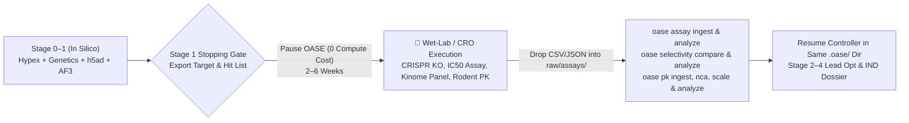

# Module 04 — Make It Yours: Custom Targets, Threshold Tuning & Wet-Lab / CRO Handoffs

> **Duration:** 30 Minutes (`1:30 – 2:00`)  
> **Hands-On Goal:** Configure a custom discovery campaign from a menu of public targets/indications, customize `.oase/thresholds.yaml` without re-running expensive Phase 1 Vertex AI calls, configure a **Wet-Lab / CRO Stopping Gate**, and re-ingest experimental assay data (`oase assay`, `oase selectivity`, `oase pk`).

---

## 1. Choose Your Pod's Target & Indication Menu

Pick one of the pre-vetted public target/indication pairings below—or bring any human UniProt accession and disease ontology ID of your choice:

| Option | Target (`UniProt` / `Gene`) | Indication | Modality | Key GCP & OASE Tools Stressed |
|---|---|---|---|---|
| **Option A (Immunology)** | `IRAK4` (`Q9NWZ3`) or `TYK2` (`P29597`) | Hidradenitis Suppurativa / Psoriasis | Small-molecule kinase inhibitor or PROTAC degrader | `AlphaGenome` (`score-variant`), `gnomAD`, `DICE` immune expression, `AlphaFold 3` (`--template ligand`), `selectivity` |
| **Option B (Fibrosis / Metabolic)** | `LOXL2` (`Q9Y4K0`) or `PNPLA3` (`Q9NST1`) | MASH / Hepatic Fibrosis (F3–F4) | Small molecule or ASO/siRNA | `AlphaGenome`, `GTEx` vs. `oase h5ad` (`DISCO`/`CELLxGENE` cirrhotic single-cell), `AlphaFold 3`, `fpocket` |
| **Option C (Oncology)** | `PRMT5` (`O14744`) or `WRN` (`Q14191`) | `MTAP`-deleted or `MSI-H` Solid Tumors | Synthetic-lethal small molecule | `cBioPortal`, `OpenTargets`, `AlphaFold 3` (`--template complex` / `--template ligand`), `AutoDock Vina`, `RDKit ADMET` |
| **Option D (Cardiometabolic)** | `PCSK9` (`Q8NBP7`) or `APOC3` (`P02656`) | Familial Hypercholesterolemia / Severe Hypertriglyceridemia | Oral small-molecule or macrocyclic peptide | `gnomAD` human loss-of-function (`pLI`/`LOEUF`), `GWAS Catalog v2`, `AlphaFold 3` PPI complex (`LDLR`), `ClinicalTrials.gov` |

---

## 2. Live Exercise 4.1: Re-Analyze Layer 0 Artifacts Under Custom Program Thresholds (`<1 sec`, `$0` Cost)

Why does OASE enforce the **Two-Phase Split (`fetch` vs. `analyze`)** so strictly? Because in real pharma programs, teams routinely tighten or relax a threshold when shifting modalities (e.g., oral small molecule vs. topical dermal delivery vs. covalent inhibitor).

Because all 51 `oase <tool> analyze*` commands are **network-latched offline** and read from `raw/`, you can change `.oase/thresholds.yaml` and re-compute every verdict in milliseconds without spending another dime on Vertex AI GPU endpoints or re-querying external APIs:

```bash
source /scion-volumes/tools/env.sh
export OASE_PROJECT=/workspace/live-sandbox

# 1. Inspect the program's active threshold configuration
cat /workspace/live-sandbox/.oase/thresholds.yaml

# 2. Run Phase 1 + Phase 2 compound & ADMET profiling on a candidate SMILES (EED226)
oase compound profile "CC1=NN(C=C1)C2=CC=C(C=C2)C3=NC=C4C(=N3)N(C=C4)CC5=CC=CC=C5" --name EED226
oase compound analyze --name EED226
oase admet predict "CC1=NN(C=C1)C2=CC=C(C=C2)C3=NC=C4C(=N3)N(C=C4)CC5=CC=CC=C5" --name EED226
oase admet analyze "CC1=NN(C=C1)C2=CC=C(C=C2)C3=NC=C4C(=N3)N(C=C4)CC5=CC=CC=C5" --name EED226

# 3. Inspect the stamped thresholds_applied and threshold_sources in the output JSON
#    (Note: --name EED226 normalizes to lowercase slug 'eed226' on disk)
jq '.thresholds_applied, .threshold_sources' /workspace/live-sandbox/raw/compounds/eed226.analysis.json
```

Now edit `/workspace/live-sandbox/.oase/thresholds.yaml` (for example, tightening the molecular weight or Lipinski/Veber cutoffs) and re-run `oase compound analyze --name EED226 --overwrite` (note that without `--overwrite`, OASE refuses a conflicting analysis overwrite with exit code `9` to prevent silent tampering!). Notice:
1. It completes in **`<0.2 seconds`** with zero network traffic.
2. `threshold_sources` in `eed226.analysis.json` automatically flips from `"default"` to `"program_override"`, so `oase validate check` and the `Scientific Reviewer` know the exact threshold rule in force!

---

## 3. Live Exercise 4.2: Configurable Stopping Gates & Wet-Lab / CRO Assay Re-Ingestion

Real pre-clinical discovery is a hybrid loop between computational triage and physical wet-lab experimentation (internal bench biology or external CROs like WuXi AppTec, Charles River, or Eurofins). OASE never forces a blind 5-stage computer march.



### Step A: Configure a Wet-Lab Stopping Gate in Your Directive
When launching or messaging `science-program-lead`, specify your exact stopping boundary:
- **Gate 1 (Target Validation Handoff):** *"Stop after Stage 1 target validation (`WO-006`) and emit a wet-lab CRISPR/siRNA & primary-cell validation protocol."*
- **Gate 2 (Hit-to-Lead CRO Synthesis & Screening Handoff):** *"Stop after Stage 2 virtual screening & retrosynthesis (`oase screen`, `oase docking`, `oase retro`) and export a top-20 compound ordering & biochemical assay sheet."*

### Step B: Re-Ingest Physical Wet-Lab / CRO Data into OASE
When your wet-lab or CRO returns experimental dose-response, selectivity panel, or in vivo PK data, drop the files into `<program>/raw/` and run OASE's experimental ingestion tools:

```bash
# 1. Ingest and analyze T3 biochemical/cellular IC50 assay results (oase.assay.v1 schema)
oase assay ingest raw/assays/cro-batch-01.json
oase assay analyze raw/assays/cro-batch-01.assay.json

# 2. Compute off-target selectivity fold-margins against safety panels (oase.selectivity-panel.v1 schema)
oase selectivity compare raw/assays/selectivity-panel-01.json
oase selectivity analyze raw/assays/selectivity-panel-01.selectivity.json

# 3. Ingest in vivo rodent PK data, run non-compartmental analysis (NCA), and project human dose
oase pk ingest raw/assays/rat-pk-01.json
oase pk nca raw/pk/rat-pk-01.pk-study.json --blq-method exclude
oase pk scale raw/pk/rat-pk-01.pk-nca.json
oase pk analyze raw/pk/rat-pk-01.pk-scaling.json
```

### Standing Rule #2: Measurements Always Outrank Predictions (`docs/tool-design-guidance.md` §1.1)
In OASE, **a model prediction never overrides a primary measurement**:
- Measured values (`oase assay`, `oase pk`, `oase expression`) and predicted values (`oase admet`, `oase docking`, `oase alphafold`) are kept strictly separate in Layer 1 findings.
- When an `AutoDock Vina` or `RDKit ADMET` prediction disagrees with the re-ingested CRO `oase assay` measurement, **the disagreement itself is surfaced as the finding**, automatically triggering the `Medicinal Chemist` to recalibrate the SAR model for Stage 3!

---

**Next Step:** Proceed to [Module 05 — Extend OASE with Custom Tools (`oase h5ad`)](05-extend-custom-tools.md).
