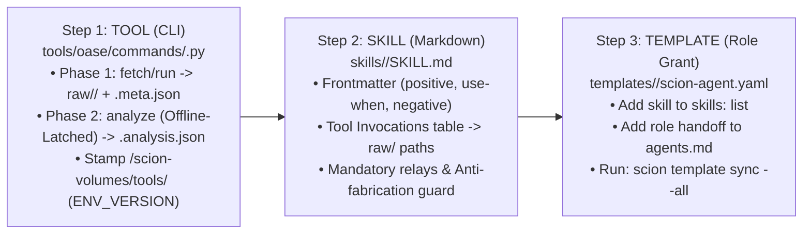

# Module 05 — Extend OASE with Custom Tools: The 3-Step Container Contract (`Tool → Skill → Template`) & `oase h5ad` Case Study

> **Duration:** 30 Minutes (`2:00 – 2:30`)  
> **Audience:** AI Platform Engineers, Computational Biologists, and Bioinformatics Developers  
> **Hands-On Goal:** Learn how to onboard any custom Python library, compiled binary, Docker container, or internal R&D REST service into GCP-OASE in **3 steps**—and inspect the real **`oase h5ad`** single-cell tool (`49/49` unit tests passing) built during `pilot-10`.

---

## 1. The Real-World Catalyst: Why `pilot-10` Needed `oase h5ad`

During **`pilot-10` (Hepatic Fibrosis Stage 0→1)**, the `Computational Biologist` investigated whether candidate extracellular matrix targets (`MMP13`, `MMP1`, `MMP8`) were expressed in human liver:
1. **The Bulk-Tissue Trap:** Healthy bulk liver RNA-seq from GTEx (`oase gtex fetch`) showed near-zero expression (`<0.5 TPM`), because activated hepatic stellate and scar-associated mesenchymal cells only expand inside **cirrhotic/fibrotic** tissue.
2. **The Missing Instrument:** When `wo006-r1-computational-biologist` searched single-cell atlases (`DISCO` and `CELLxGENE`), `oase` had discovery search commands (`oase disco search`, `oase cellxgene search`)—and `commands/disco.py` even had a response-boundary bug where `_extract_sample_record` looked for `project` instead of `project_id`—but **no tool existed to download raw `.h5` / `.h5ad` count matrices and compute per-cell gene counts + unsupervised sub-clustering offline**.
3. **How OASE Responded:** Instead of hallucinating single-cell numbers or dropping the target on a healthy-tissue null, `science-program-lead` opened **`OQ-017`**, and `controller` dispatched `pilot-10-h5ad-builder` in a git worktree (`feat/h5ad-reanalyse`, commit `8a64d02`) to build **`oase h5ad`**.

---

## 2. The 3-Step Custom Tool Onboarding Contract (`Tool → Skill → Template`)

In OASE, adding a new scientific capability never requires rebuilding monolithic agent container images or rewriting orchestrator code. Every custom tool follows the same **3-Step Contract**:



---

### Step 1: The Tool (`tools/oase/commands/h5ad.py` & `_h5ad_io.py`)

Let's inspect the real `oase h5ad` implementation built during `pilot-10`:

- **Phase 1 (`oase h5ad fetch ACCESSION... --source disco|cellxgene|geo|url`):**
  - Downloads the verbatim `.h5` or `.h5ad` count matrix (plus, for `DISCO`, the verbatim per-cell label TSV from `toolkit/getCellTypeSample` and sample metadata from `toolkit/getSampleMetadata`) into `<program>/raw/single-cell/`.
  - Writes a cryptographic `.meta.json` sidecar recording the source accession, download URL, `work_order_id`, `written_by`, `env_version`, and SHA-256 of every file.
- **Phase 2 (`oase h5ad analyze ACCESSION... --source S --gene G... [--select-label L] [--control ACTB]`):**
  - Automatically **network-latched offline** by OASE's root CLI guard (`docs/tool-design-guidance.md` §3).
  - Runs an offline `numpy`/`scipy`/`h5py` pipeline (`log1p CP10K → HVG → PCA → seeded k-means++`) and enforces three scientific integrity rules:
    1. **Absence vs. Failure (`parse_status`):** Every requested gene is marked `measured` (present in feature list; counts may be 0), `searched_absent` (feature list was read and the provider filtered the gene out—written as `NA`, **never `0`**), or `ambiguous_feature`.
    2. **Positive Control (`--control ACTB`):** Housekeeping control `ACTB` must have non-zero counts in every sample, or the command exits with an error.
    3. **Zero Label Guessing:** Across the 5 cirrhotic liver samples in `DISCO` (`GSM6508438`, `GSM6508440`, `SRX18764702`, `SRX18764703`, `SRX18764704`), zero labels literally contain the substring `"stellate"` (the atlas uses `"CFD+MGP+ fibroblast"`, `"CCL19+APOE+ fibroblast"`, `"Mesenchymal stromal cell"`, `"Pericyte"`). If an agent passes `--select-label "Activated stellate cell"`, `oase h5ad analyze` refuses (`exit 2`) and prints the exact vocabulary present in the file rather than guessing!

### Live Exercise 5.1: Run the `oase h5ad` Test Suite (`49/49` Passing)

Run the unit and integration test suite for `oase h5ad` right now:

```bash
source /scion-volumes/tools/env.sh
pytest /workspace/tests/test_h5ad.py -v
```

All **49 tests** pass in `<3 seconds`, verifying 10x HDF5 parsing, AnnData `.h5ad` CSR/CSC sparse matrix slicing, `measured` vs. `searched_absent` (`NA` vs `0`), positive control enforcement, and offline Phase 2 latching!

---

### Step 2: The Skill (`skills/<capability>/SKILL.md`)

Once your CLI command is registered in `tools/oase/cli.py`, expose it to agents by adding or updating a `<200-line` specialist-neutral skill in `skills/<capability>/SKILL.md` (`docs/skill-design-guidance.md` §4):

```markdown
---
name: single-cell-matrix-slicing
description: >
  Retrieve raw single-cell H5/H5AD count matrices from DISCO, CELLxGENE, GEO,
  or URLs and compute per-cell gene counts and unsupervised sub-clusters offline.
  Use when bulk tissue RNA-seq (GTEx/HPA) may mask a disease-specific or rare
  cell-type population, or when verifying whether a gene is truly unexpressed
  versus absent from a provider's filtered feature list. Do not use for initial
  study discovery (use disco or cellxgene search first).
---

## Tool Invocations

| Question | Run | Writes to |
|---|---|---|
| Download raw H5/H5AD + labels | `oase h5ad fetch <ACCESSION>... --source disco\|cellxgene\|geo\|url` | `raw/single-cell/<slug>.h5ad`<br>`raw/single-cell/<slug>.meta.json` |
| Compute per-cell counts & sub-clusters offline | `oase h5ad analyze <ACCESSION>... --source <S> --gene <G>... --control ACTB` | `raw/single-cell/<key>.cells.tsv`<br>`raw/single-cell/<key>.analysis.json` |

## Anti-Fabrication Guard
Do not compute per-cell counts or map cell-type labels yourself. `searched_absent`
means the gene was omitted from the provider's feature list (`NA`), NOT zero expression (`0`).
```

---

### Step 3: The Template (`templates/<role>/scion-agent.yaml`)

Grant the capability to the relevant specialist role(s) and sync to the Scion Hub:

```yaml
# In templates/computational-biologist/scion-agent.yaml:
skills:
  - target-genetic-evidence
  - tissue-expression-profiling
  - single-cell-matrix-slicing
```

```bash
# Sync updated templates to the Scion Hub and update the shared volume stamp
cd /workspace/tools && ./install.sh --update
scion template sync --all
oase doctor
```

---

## 3. Four Blueprints for Onboarding Internal R&D Tools (Patterns A–D)

Depending on how your internal R&D tool is packaged, choose one of the four supported integration patterns (`docs/tool-design-guidance.md` §2):

| Pattern | Best For... | How It Plugs Into OASE |
|---|---|---|
| **Pattern A: Pure-Python / Wheel in Shared Venv** | Internal Python SDKs, `scanpy`/`h5py`/`RDKit` scripts (`oase h5ad`) | Add package to `tools/requirements-science.txt`, add `tools/oase/commands/<tool>.py` with `fetch` + `analyze`, run `./install.sh --update`. |
| **Pattern B: Static Compiled Binary in `/scion-volumes/tools/bin/`** | C++/Rust/Go structural or chemistry binaries (`AutoDock Vina`, `fpocket`, internal aligners) | Drop static binary into `/scion-volumes/tools/bin/`, record binary hash in `ENV_VERSION` manifest, invoke via `subprocess.run` inside `oase <tool> run`. |
| **Pattern C: Sidecar Docker Container on Scion Bridge Network** | Tools with heavy conflicting OS/CUDA/Conda dependencies (e.g., OpenBabel, PyMOL, proprietary QM solvers) | Run the container as a local sidecar service on the Scion host bridge; `oase <tool> run` calls `http://localhost:<port>/run`, writes `raw/<class>/` + `.meta.json`, and `oase <tool> analyze` parses the output offline. |
| **Pattern D: Remote Vertex AI Endpoint or Cloud Run Service** | GPU foundation models (`AlphaFold 3`, `AlphaGenome`, `Boltz-2`, internal GNNs) | Authenticate via GCE Metadata ADC (`google.auth.default()`), guard concurrency with `oase/core/qps.py` or a file lock (`flock`), save raw response under `raw/` in Phase 1, and decode/threshold offline in Phase 2. |

---

**Next Step:** Facilitators see [Module 06 — Facilitator Run-of-Show Guide](06-facilitator-guide.md); engineers see [Module 07 — Troubleshooting](07-troubleshooting.md).
